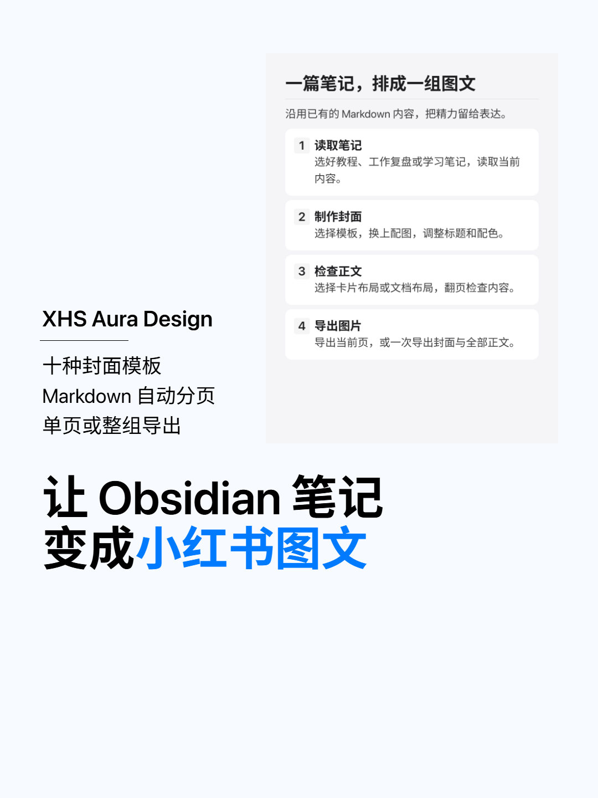
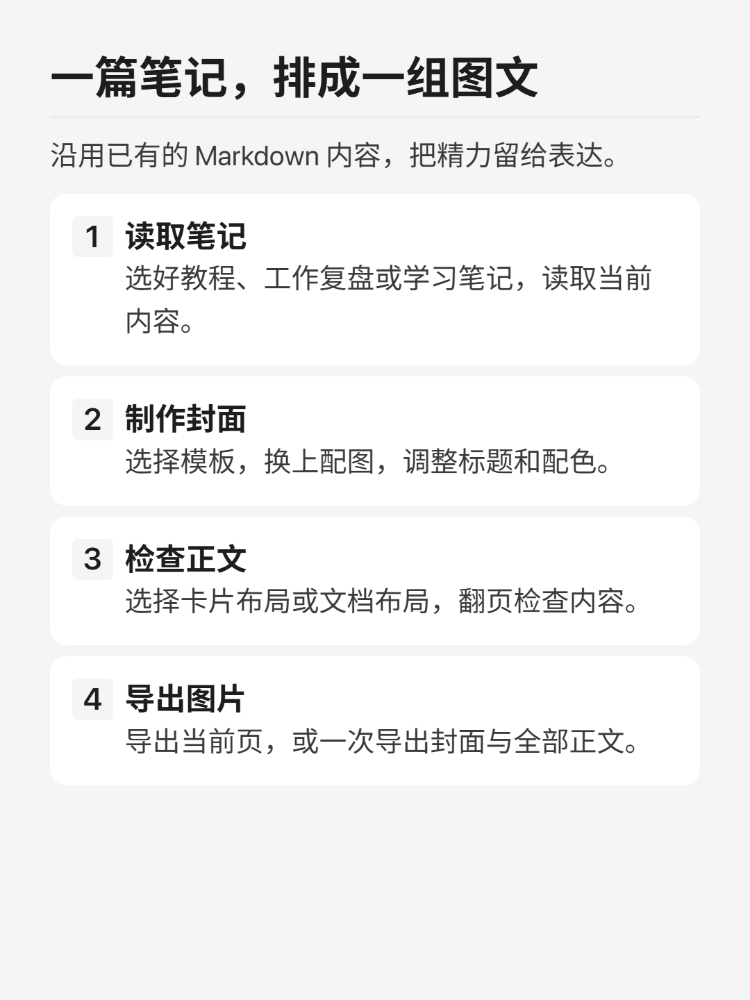
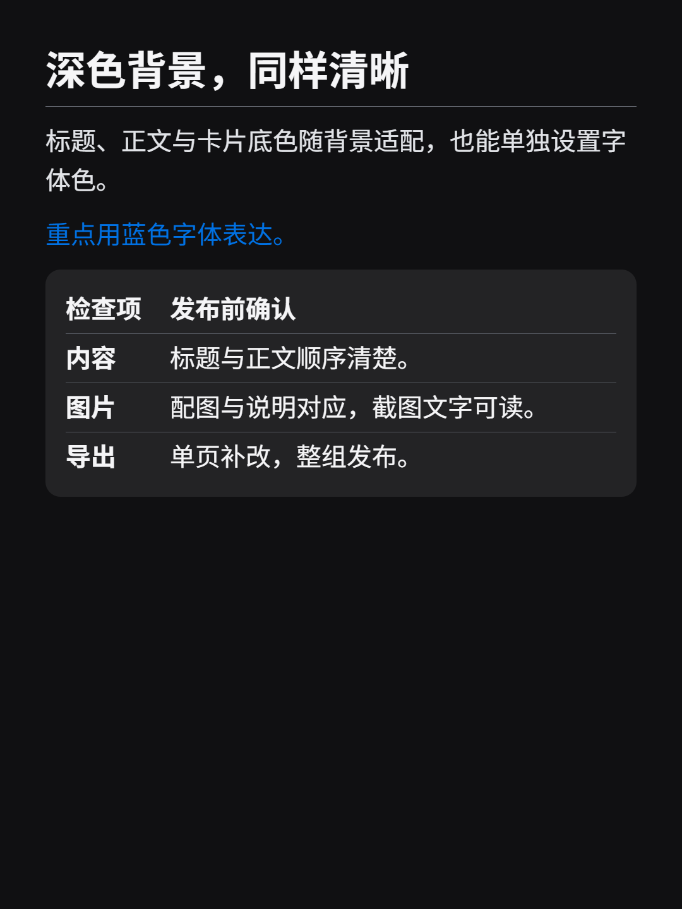
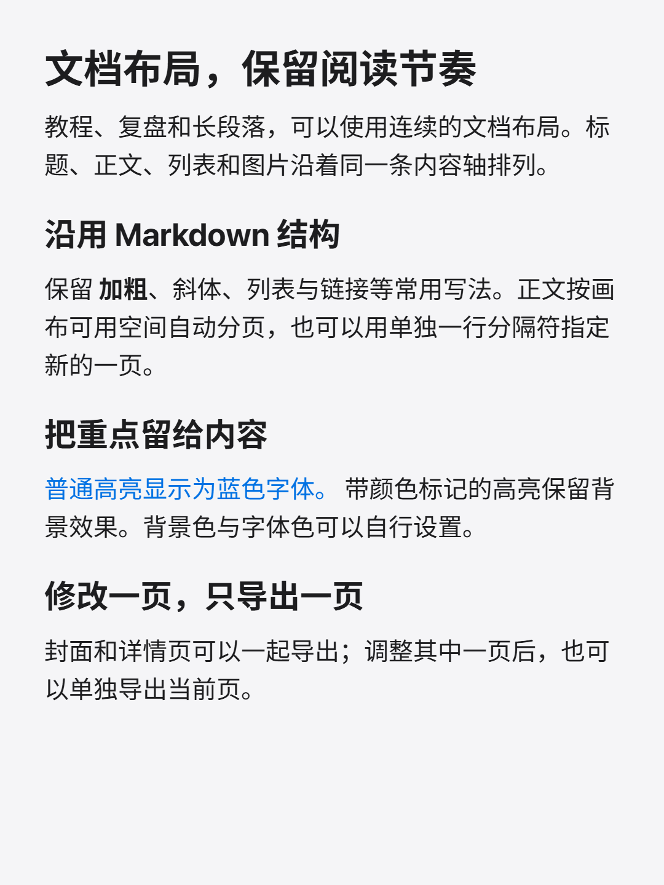

# XHS Aura Design（小红卡）

**把 Obsidian 的 Markdown 笔记，做成带封面、可分页的小红书图文。**

直接读取已有的教程、工作复盘或学习笔记，在同一个工作台完成封面排版、正文卡片与高清 PNG 导出。

[下载最新版本](https://github.com/Jackiechan24/xhs_card_studio/releases/latest) · [查看使用示例](example-note.md)

## 可以做什么

- **十种封面模板。** 上题中图、上图下题、主辅三图、左右图文、满版叠字、杂志标题和上下对比等布局，适配教程、工具介绍与效果展示。
- **封面自由编辑。** 自定义图片、主标题、副标题、辅助文案与配色；独立移动、缩放模块，添加图片 Logo、描边标签、胶囊标签和角标框。
- **Markdown 自动排版与分页。** 识别标题、段落、步骤、清单、表格与图片，生成相应内容模块。支持用单独一行 `---` 指定分页。
- **卡片布局与文档布局。** 结构化内容使用卡片，连续阅读使用文档；支持单双列内容编排，统一标题层级、模块间距与卡片留白。
- **自定义背景色和字体色。** 适配深浅背景。普通 `==文字==` 显示蓝色字体，`==🔴文字==` 等带颜色标记的写法保留背景高亮。
- **单页或整组导出。** 封面与全部详情页可以一次导出高清 PNG，也可以只导出修改后的当前页。排版参数可保存到笔记，方便继续编辑。

## 最新效果示例

以下四张图片由 **0.9.13** 插件实际生成，点击可查看完整图片。

<table>
  <tr>
    <td width="50%" align="center"><strong>封面：图文组合与关键词高亮</strong> </td>
    <td width="50%" align="center"><strong>卡片布局：教程步骤</strong> </td>
  </tr>
  <tr>
    <td width="50%" align="center"><strong>深色详情：表格与高亮</strong> </td>
    <td width="50%" align="center"><strong>文档布局：连续阅读</strong> </td>
  </tr>
</table>

## 安装与使用

推荐从 [GitHub Releases](https://github.com/Jackiechan24/xhs_card_studio/releases/latest) 下载同一版本的 `main.js`、`manifest.json` 和 `styles.css`，放入知识库的 `.obsidian/plugins/xhs-card-studio/` 目录，在 Obsidian 的第三方插件设置中启用。插件 ID 保持为 `xhs-card-studio`。

也可以通过 [Obsidian 插件入口](https://community.obsidian.md/plugins/xhs-card-studio) 查找插件。

1. 打开一篇 Markdown 笔记，点击功能区图片图标，或运行命令「打开小红书图文工作台」。
2. 点击「读取当前笔记」，选择封面模板，双击图片框添加配图，填写文案并调整配色。
3. 翻到详情页，选择「卡片布局」或「文档布局」，设置字号、背景色和字体色。
4. 逐页检查，导出当前页或全部页面。需要继续编辑时，点击「保存参数到笔记」。

[示例笔记](example-note.md)包含四个阶段的 Markdown 写法和手动分页示例。

排版和 PNG 生成在本地完成。导入图片会复制到知识库，导出文件写入你选择的位置。「保存参数到笔记」会更新笔记属性。引用远程图片时，预览或导出可能向图片原地址发起请求。

## English Quick Start

XHS Aura Design turns Obsidian Markdown notes into Xiaohongshu covers and multi-page image posts. It includes ten editable cover templates, card and document layouts, custom colors, automatic pagination, and single-page or batch PNG export.

Download `main.js`, `manifest.json`, and `styles.css` from the [latest release](https://github.com/Jackiechan24/xhs_card_studio/releases/latest), place them in `.obsidian/plugins/xhs-card-studio/`, and enable the plugin in Obsidian desktop. Open a note, launch the image workbench, read the note, customize the cover, review the detail pages, and export.

[MIT License](LICENSE)
