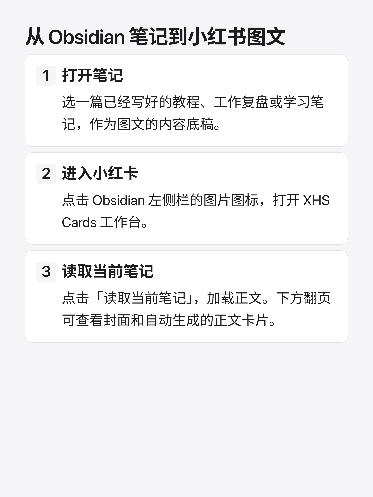
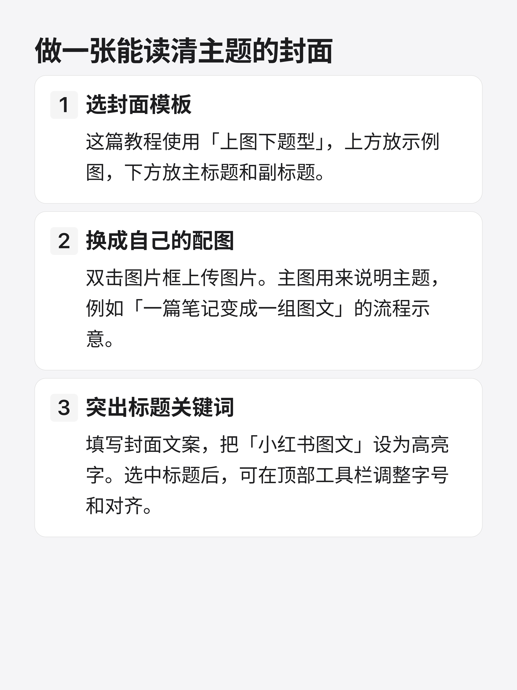
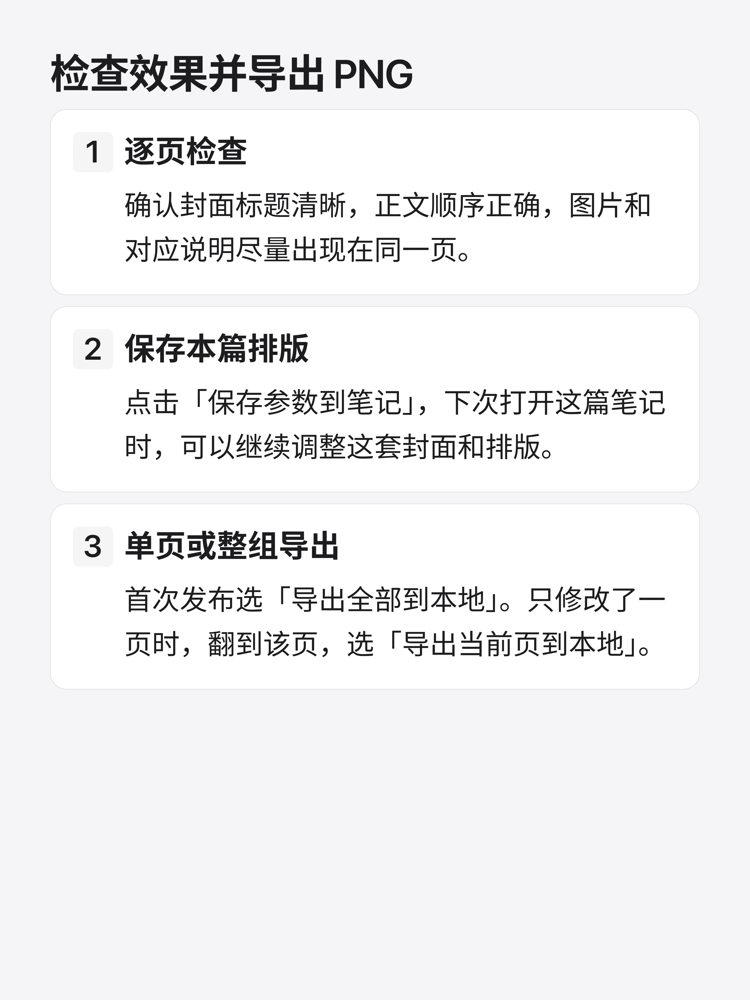

# XHS Aura Design（小红卡）

**将 Obsidian 笔记排版为可发布的小红书图文卡片。**

用一篇已有的教程、工作复盘或学习笔记做底稿，在同一个工作台完成封面编辑、正文分页和图片导出。

## 产品特点

- **Markdown 自动排成卡片。** 直接读取 Obsidian 笔记，沿用标题和列表结构自动分页。编号列表可以排成独立步骤卡，适合教程和操作流程。
- **按内容选择封面模板。** 教程可以用上图下题突出主题，前后效果可以用上下对比展示。从合适的版式开始，省去搭建封面的时间。
- **封面排版可自由调整。** 换上自己的配图、文案和配色，独立移动标题、副标题与辅助文案，也可以添加标签和角标框。
- **整组或单页导出高清 PNG。** 封面和正文卡片可一次全部导出，也可以单独导出当前页，方便补发或替换。

## 安装与使用

在桌面版 Obsidian 打开「设置 → 第三方插件 → 浏览」，搜索 **XHS Aura Design** 并安装启用。也可以从 [官方插件页](https://community.obsidian.md/plugins/xhs-card-studio) 打开安装入口。

手动安装时，从 [GitHub Releases](https://github.com/Jackiechan24/xhs_card_studio/releases) 下载同一版本的 `main.js`、`manifest.json` 和 `styles.css`，放入知识库的 `.obsidian/plugins/xhs-card-studio/` 目录，重启 Obsidian 后启用插件。

1. 打开 Markdown 笔记，点击 Obsidian 功能区的图片图标，或在命令面板运行「打开小红书图文工作台」。
2. 选择封面模板，填写文案，双击图片框添加配图。
3. 翻页检查正文卡片，导出当前页或全部页面。需要继续调整时，可以把排版参数保存到笔记。

## 图文示例

[示例笔记](example-note.md)展示了如何从打开笔记开始，完成封面、正文分页和 PNG 导出。

<table>
  <tr>
    <td align="center"><strong>打开笔记</strong> </td>
    <td align="center"><strong>制作封面</strong> </td>
  </tr>
  <tr>
    <td align="center"><strong>排版正文</strong> </td>
    <td align="center"><strong>检查并导出</strong> </td>
  </tr>
</table>

排版和 PNG 生成在本地完成。导入图片会复制到知识库，导出文件写入你选择的位置。「保存参数到笔记」会更新笔记属性。引用远程图片时，预览或导出可能向图片原地址发起请求。

## English Quick Start

XHS Aura Design turns Markdown notes into Xiaohongshu covers and multi-page image cards. It combines editable cover templates, automatic pagination, and high-resolution PNG export in one workspace.

In Obsidian desktop, open **Settings → Community plugins → Browse**, search for **XHS Aura Design**, and install and enable it. Open a note and click the image icon in the ribbon. Choose a cover template, preview the cards, and export the current page or the full set.

[MIT License](LICENSE)
