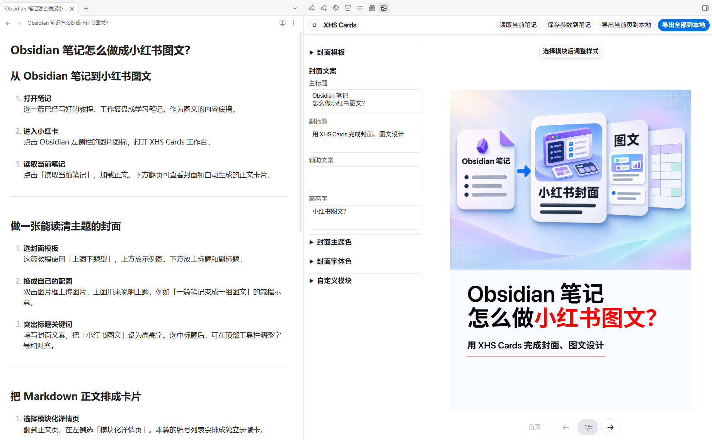
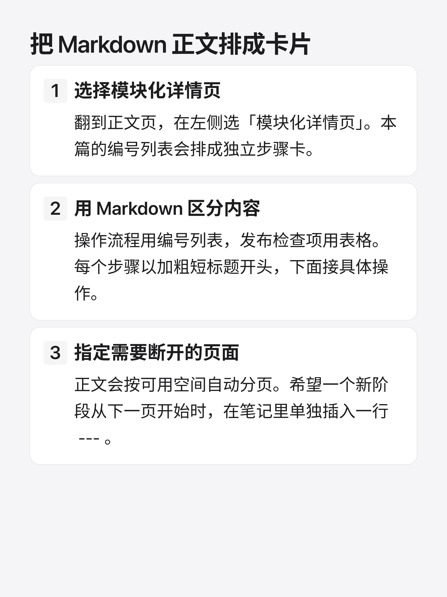

# XHS Cards（小红卡）

**将 Obsidian 笔记排版为可发布的小红书图文卡片。**

用一篇已有的教程、工作复盘或学习笔记做底稿，在同一个工作台完成封面编辑、正文分页和图片导出。

## 产品特点

- **用已有笔记直接制作图文。** Markdown 正文自动分页，编号列表可以排成独立的步骤卡。
- **用模板搭出自己的封面。** 从现成版式起步，按主题编辑文案、图片和配色。
- **按需导出高清图片。** 检查整组排版后，可一次导出全部 PNG，也可只补导修改过的一页。

## 安装与使用

在桌面版 Obsidian 打开「设置 → 第三方插件 → 浏览」，搜索 **XHS Cards** 并安装启用。也可以从 [官方插件页](https://community.obsidian.md/plugins/xhs-card-studio) 打开安装入口。

手动安装时，从 [GitHub Releases](https://github.com/Jackiechan24/xhs_card_studio/releases) 下载同一版本的 `main.js`、`manifest.json` 和 `styles.css`，放入知识库的 `.obsidian/plugins/xhs-card-studio/` 目录，重启 Obsidian 后启用插件。

1. 打开 Markdown 笔记，点击 Obsidian 功能区的图片图标，或在命令面板运行「打开小红书图文工作台」。
2. 选择封面模板，填写文案，双击图片框添加配图。
3. 翻页检查正文卡片，导出当前页或全部页面。需要继续调整时，可以把排版参数保存到笔记。

## 图文示例

[示例笔记](example-note.md)展示了如何从打开笔记开始，完成封面、正文分页和 PNG 导出。

完整流程：[打开笔记](docs/readme/02-open-note.png) · [制作封面](docs/readme/03-make-cover.png) · [排版正文](docs/readme/04-markdown-cards.png) · [检查并导出](docs/readme/05-export.png)

排版和 PNG 生成在本地完成。导入图片会复制到知识库，导出文件写入你选择的位置。「保存参数到笔记」会更新笔记属性。引用远程图片时，预览或导出可能向图片原地址发起请求。

## English Quick Start

XHS Cards turns Markdown notes into Xiaohongshu covers and multi-page image cards. It combines editable cover templates, automatic pagination, and high-resolution PNG export in one workspace.

In Obsidian desktop, open **Settings → Community plugins → Browse**, search for **XHS Cards**, and install and enable it. Open a note and click the image icon in the ribbon. Choose a cover template, preview the cards, and export the current page or the full set.

[MIT License](LICENSE)
